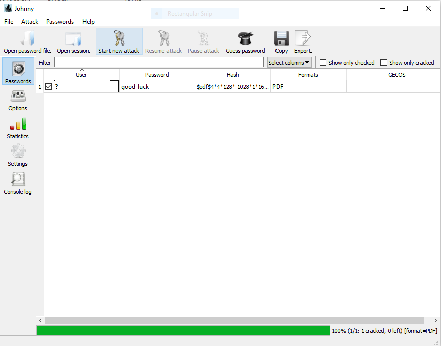
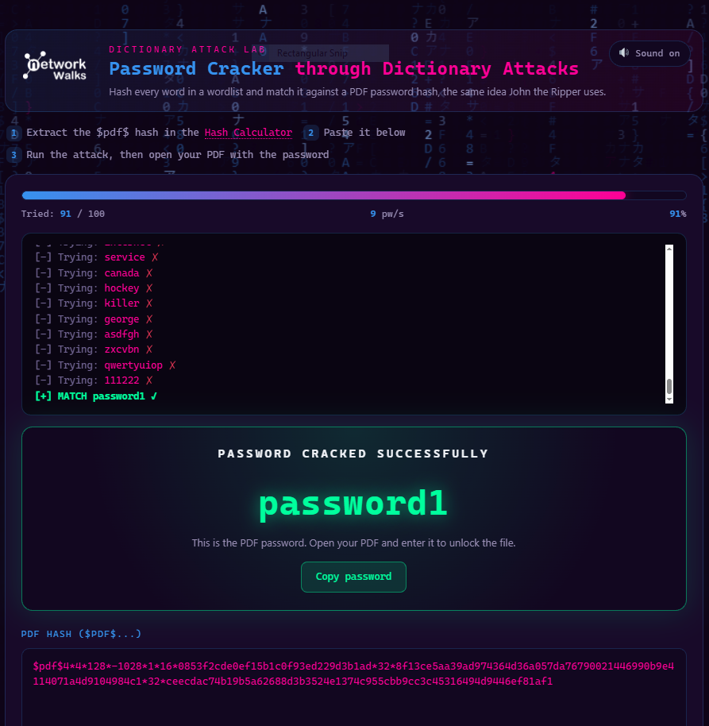

# 🔐 PDF Password Cracking Labs — Week 3 (Modules 1 & 2)


## 📌 Overview

This repository documents two hands-on cybersecurity lab tasks focused on auditing password strength and recovering lost credentials from encrypted PDF documents (`My Locked PDF1.pdf`):

* **Project Module 1:** Offline password recovery using **John the Ripper (JTR)** CLI and **Johnny GUI** on Windows.
* **Project Module 2:** Browser-based hash extraction and dictionary cracking using **Networkwalks Online Tools**.

---

## 🛠️ Project Module 1: Password Cracking with John the Ripper (JTR) & Johnny GUI

### Objective
Extract the cryptographic hash from `My Locked PDF1.pdf` and recover its document-open password using **John the Ripper** (`1.9.0-jumbo-1`) paired with the **Johnny** graphical interface (`v2.2`) on Windows *(Note: JTR comes pre-installed on Kali Linux)*.

### Tools Used
* **John the Ripper (Windows 64-bit Jumbo):** [openwall.com/john](https://www.openwall.com/john/)
* **Johnny GUI (`v2.2`):** [openwall.info/wiki/john/johnny](https://openwall.info/wiki/john/johnny)
* **PDF Hash Extractor (`pdf2john`):** [onlinehashcrack.com/tools-pdf-hash-extractor.php](https://www.onlinehashcrack.com/tools-pdf-hash-extractor.php)

### Steps

1. **Install & Configure JTR + Johnny:**
   * Download and extract **John the Ripper (`john-1.9.0-jumbo-1-win64`)**.
   * Install **Johnny GUI (`johnnyInstaller.exe`)**, open **Settings** $\rightarrow$ **Browse**, and select `...\john-1.9.0-jumbo-1-win64\run\john.exe`.
2. **Extract & Save the PDF Hash:**
   * Upload `My Locked PDF1.pdf` to the OnlineHashCrack PDF Hash Extractor and copy the `$pdf$...` hash string *(without any extra characters like `b'`)*.
   * Paste it into Notepad and save as `hash1.txt`.
3. **Crack the Password in Johnny:**
   * Click **Open password file** $\rightarrow$ **Open password file (PASSWD format)**, load `hash1.txt`, and click **Start new attack**.
   * Johnny cracks the hash and reveals the password (`password1`):

   

4. **Unlock the PDF:**
   * Open `My Locked PDF1.pdf` and enter `password1` to unlock the file and capture the flag.

---

## 🌐 Project Module 2: Password Cracking with Networkwalks Web Tools

### Objective
Crack the password of `My Locked PDF1.pdf` directly in a web browser without installing local tools using Networkwalks' **Hash Calculator** and **Password Cracker**.

### Tools Used
* **Lab Portal & Target File:** [Networkwalks Project Task Lab](https://networkwalks.com/project-task-lab-password-cracking-with-networkwalks-tools/)
* **Networkwalks Hash Calculator:** [networkwalks.com/hash-calculator](https://networkwalks.com/hash-calculator/)
* **Networkwalks Password Cracker:** [networkwalks.com/password-cracker](https://networkwalks.com/password-cracker/)

### Steps

1. **Extract the Hash Locally:**
   * Open the **Networkwalks Hash Calculator**, go to the **PDF** tab, and upload `My Locked PDF1.pdf`.
   * Copy the extracted hash:
     ```text
     $pdf$4*4*128*-1060*1*16*55d1a5c14175da449753199e44971d32*32*777fd021a7f3c5ae598c0c6495c7f76e00000000000000000000000000000000*32*ceecdac74b19b5a62688d3b3524e1374c955cbb9cc3c45316494d9446ef81af1
     ```
2. **Run the Dictionary Attack:**
   * Open the **Networkwalks Password Cracker**, paste the `$pdf$` hash into the box, keep the **Built-in list (100 passwords)** selected, and click **START CRACKING**.
   * The tool finds a match (`password1`) at attempt `91 / 100`:

   

3. **Unlock the PDF:**
   * Open `My Locked PDF1.pdf` and enter `password1` to reveal the completion flag.

---

## 🧠 Key Takeaways

| Concept | How It Works | Direction | Purpose |
| :--- | :--- | :--- | :--- |
| **Encryption** | Scrambles plaintext using a key | **Two-way** (reversible) | Protects confidentiality of files and data |
| **Hashing** | Converts input into a fixed-length digest | **One-way** (irreversible) | Validates integrity and stores password verifiers |

* **Password Strength:** Common passwords like `password1` are cracked almost instantly by dictionary attacks. Using 12+ characters with mixed uppercase, lowercase, numbers, and symbols prevents rapid offline cracking.

---

## ⚠️ Disclaimer

Performed strictly in an authorized educational lab environment on sample files (`My Locked PDF1.pdf`) for learning defensive cybersecurity and password auditing.
